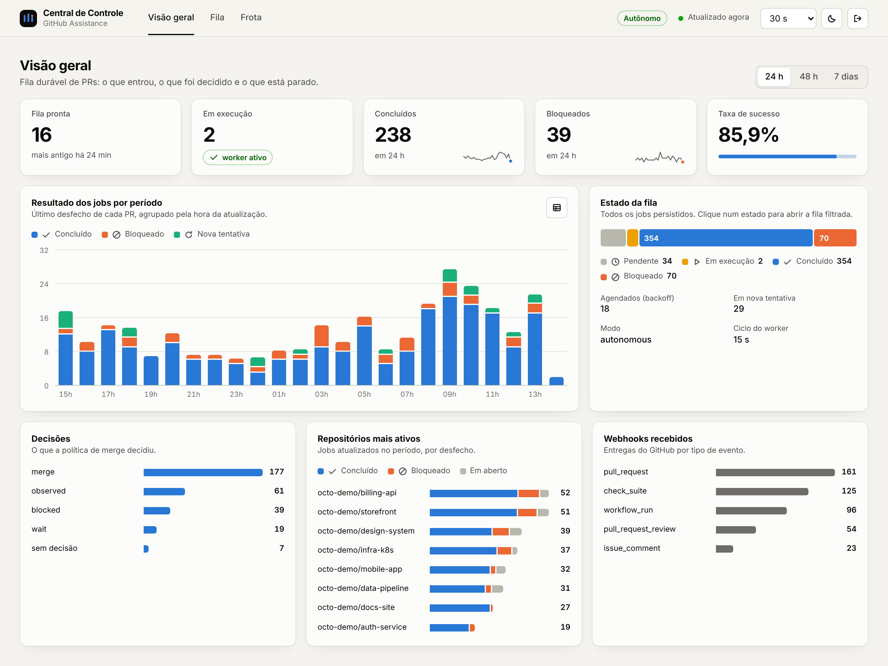

# Github Assistance

[](https://github.com/juninmd/github-assistance/actions/workflows/validate.yml)
[](https://codecov.io/gh/juninmd/github-assistance)
[](https://github.com/juninmd/github-assistance/actions/workflows/security.yml)
[](https://bun.sh)
[](https://www.typescriptlang.org)

A fleet of AI agents that maintains a GitHub portfolio on autopilot: it merges
and fixes pull requests, scans for leaked secrets, keeps dependencies and
READMEs fresh, cleans stale branches and delegates larger coding work to
[opencode](https://opencode.ai).

Agent personas, rules and the interaction protocol live in [AGENTS.md](AGENTS.md).
The durable queue, merge policy and operations are in
[docs/ARCHITECTURE.md](docs/ARCHITECTURE.md).

## Agents

8 agents, each with one scope, are declared in one table, `ts/src/agents/catalog.ts`, and run through one CLI.
Some of them run former agents as internal **stages**.

| Agent | Scope | Stages | Autonomy |
|---|---|---|---|
| `secret-guard` | Gitleaks on the whole portfolio + no-cron policy; removes a real secret from git history **only after the owner approves** (Telegram button or `/aprovar` on the approval issue) | `scan`, `remove` | suggest |
| `pr-assistant` | Owns every PR: AGENTS.md gate, diff-only review, SAST, inline conflicts, checks and squash merge via the safe-merge policy | | merge |
| `flow-watch` | Reports failing pipelines and stale PRs on Telegram; opens nothing | `ci`, `sla` | observe |
| `dependency-manager` | CVEs first, then safe patch/minor updates, in one grouped, tested PR | | fix |
| `repo-standards` | `AGENTS.md` / `.agents/` in every active repo (missing AGENTS.md first, capped per run, one open PR per repo) and README upkeep | `agents-md`, `readme` | fix |
| `branch-cleaner` | Deletes branches already merged into the default branch | | fix |
| `builder` | Roadmap, code and UI improvements via opencode. PRs are **draft + `keep-draft`**: reviewed by the bot, never marked ready or merged by it | `plan`, `code`, `ui` | fix, no merge |
| `project-creator` | Scaffolds a new project from a portfolio-grounded idea (opt-in) | | suggest |

Former names still work and run only their stage, so existing CronJobs keep their behavior:
`security-scanner`, `secret-remover`, `ci-health`, `pr-sla`, `intelligence-standardizer`, `readme-curator`,
`product-manager`, `senior-developer`, `interface-developer`. `code-reviewer` and `conflict-resolver` are retired
(their work runs inside `pr-assistant`): those names now exit as a no-op with a warning, so a leftover CronJob
never starts a second PR pass.

Every opencode run uses the owner's contract: global `AGENTS.md` + skills from
[juninmd/skills](https://github.com/juninmd/skills) (refreshed at runtime, at most hourly, with the image copy as
fallback; the commit goes into PR bodies and review footers), the tokenix code index, free opencode models with
`litellm/cloud/auto` as fallback, and the `juninmd-bot` GitHub App identity.

## Quick start

Requires [Bun](https://bun.sh) 1.4+ (Node.js is only needed on the host that runs `build_check`/`conflict-resolver` against `npm` repos).

```bash
cd ts && bun install         # install dependencies
cp ../.env.example ../.env   # fill in GITHUB_TOKEN, AI keys...

bun src/cli/run-agent.ts pr-assistant                       # run one agent
bun src/cli/run-agent.ts pr-assistant --pr owner/repo#42    # target a single PR
bun src/cli/run-agent.ts repo-standards --ai-provider gemini --ai-model gemini-2.5-flash
bun src/cli/run-agent.ts all                                # all enabled agents, in dependency order
```

Results are written to `results/*.json` and summarized on Telegram.

## Dashboard

The webhook server ships a control-room UI at `/dashboard/` — queue health,
outcome charts, a searchable job table with a detail drawer (reprocess, explain
why a PR was not merged) and the agent fleet. It is plain HTML/CSS/ES modules
(no build step, no CDN, strict CSP) and reads `/api/*` with `ADMIN_API_TOKEN`.



```bash
# Try it locally with deterministic demo data
bun ts/scripts/seed-demo-queue.ts --db /tmp/demo/webhooks.db
ADMIN_API_TOKEN=demo WEBHOOK_DATABASE_PATH=/tmp/demo/webhooks.db WORKER_ENABLED=false \
  GITHUB_TOKEN=x bun ts/src/webhooks/server.ts   # http://localhost:8080/dashboard/ (token: demo)
```

Performance evidence and how to reproduce it: [docs/BENCHMARK.md](docs/BENCHMARK.md).

## Configuration

Everything is read from environment variables (see `.env.example` and
`ts/src/config/settings.ts`).

| Variable | Purpose |
|---|---|
| `GITHUB_TOKEN` / `GH_PAT` | GitHub access (a GitHub App is also supported) |
| `GITHUB_OWNER` | Account whose repositories are managed |
| `ENABLE_AI`, `AI_PROVIDER`, `AI_MODEL` | AI on/off and model (`gemini`, `openai`, `ollama`, `litellm`) |
| `*_ENABLED` (e.g. `PR_ASSISTANT_ENABLED`) | Per-agent toggles used by `run-agent all`; former agent toggles (e.g. `PR_SLA_ENABLED`) skip that stage |
| `TELEGRAM_APPROVER_IDS` | Telegram user ids allowed to approve a secret-guard history rewrite (default: the private chat only) |
| `AGENT_CONTRACT_REFRESH`, `REPO_STANDARDS_MAX_PRS` | Runtime refresh of skills + global AGENTS.md (on in the image); standardization PRs per run |
| `TELEGRAM_BOT_TOKEN`, `TELEGRAM_CHAT_ID` | Notifications |
| `CONFLICT_OPENCODE_ENABLED`, `PIPELINE_FIX_ENABLED` | Opt-in opencode conflict / CI fixing |
| `CHECKS_WAIT_ENABLED`, `CHECKS_WAIT_MAX_MINUTES` | PR Assistant waits for all checks of the head SHA to finish before reviewing; no checks (or billing-blocked Actions) never wait, stuck ones stop blocking after the timeout |
| `REVIEW_WAIVE_AFTER_MINUTES`, `REVIEW_WAIVE_MAX_LINES`, `REVIEW_WAIVE_MAX_PER_RUN` | When a model outage may let a PR merge without model review |
| `MERGE_LOCAL_CHECKS_ENABLED`, `PR_ASSISTANT_RESOLVE_CONFLICTS`, `GITHUB_BOT_LOGIN` | Substitute CI for billing/no-CI PRs, inline conflicts, bot identity |
| `AUTOMATION_MODE`, `SIMULATION_MODE` | `observe` vs `autonomous`; dry-run all writes |

Repository scope is controlled by `config/repositories.json` (allowlist) and
per-repo autonomy (`observe | suggest | fix | merge`) by `config/autonomy.json`.

## Durable automation core

GitHub webhooks hit a FastAPI server (`webhook-server`), are persisted
atomically in SQLite and processed by a worker with leases, retries and
idempotency (`queue-worker`). Merges go through a single non-bypassable policy:
every check on the current head SHA must be green, and the SHA is re-validated
right before merging. Inspect decisions with `bun ts/src/cli/insight.ts explain --pr owner/repo#N`
or `GET /api/prs/{owner}/{repo}/{number}/explain`. Full details, commands and
limits (single-replica SQLite writer) are in [docs/ARCHITECTURE.md](docs/ARCHITECTURE.md).

## Deployment

The `Dockerfile` bundles Bun, Node.js, `opencode` and `gitleaks`, runs as a
non-root user under `tini`, and defaults to `run-agent pr-assistant`. Periodic
agents run as Kubernetes CronJobs/Jobs; GitHub
Actions is used for CI and policy checks only. This repository intentionally
has **no cron workflows** (enforced by `ts/scripts/check-no-cron.ts`).

## Development

```bash
cd ts
bun run typecheck   # tsc --noEmit (strict)
bun test            # bun:test
```

CI (`validate.yml`) calls the shared `base-actions` validation, then runs a
committed-secrets check, `tsc --noEmit`, `bun test` and the no-cron guard. `security.yml` runs the shared security scan (Gitleaks) and
`deploy.yml` builds and pushes the Docker image to GHCR.
Code standards (150-line files, strict typing, DRY/KISS/SOLID, squash merge) are
described in [AGENTS.md](AGENTS.md) and [CONTRIBUTING.md](CONTRIBUTING.md).

## Project layout

```
ts/src/agents/    one folder per agent (agent.ts + instructions.md)
ts/src/queue/     durable SQLite job queue and worker (bun:sqlite)
ts/src/webhooks/  Bun.serve webhook server + admin API
ts/src/insight/   PR decision explanations (CLI + API)
ts/src/ai/        Gemini / OpenAI / Ollama / LiteLLM clients
ts/src/config/    settings, allowlist, autonomy and priorities
ts/static/        dashboard (no build step)
ts/scripts/       maintenance and dry-run utilities
config/           repositories.json, autonomy.json, opencode.json
docs/             ARCHITECTURE.md, PROJECT_HEALTH.md
```

See also [ROADMAP.md](ROADMAP.md), [SECURITY.md](SECURITY.md) and [REFERENCES.md](REFERENCES.md).
